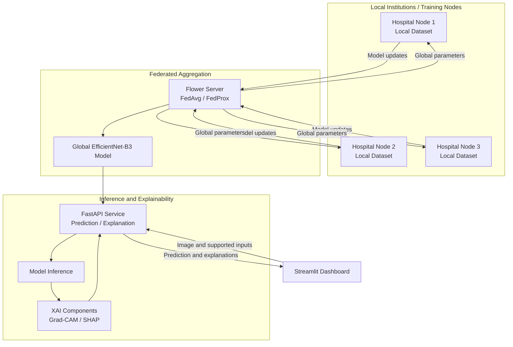

# TBSentinel

<p align="center">
  <strong>A privacy-aware, federated clinical decision-support research prototype for chest X-ray screening</strong>
</p>

<p align="center">
  <a href="https://www.python.org/"></a>
  <a href="https://pytorch.org/"></a>
  <a href="https://flower.ai/"></a>
  <a href="https://fastapi.tiangolo.com/"></a>
  <a href="https://streamlit.io/"></a>
  <a href="LICENSE"></a>
</p>

> **Research prototype — not for clinical diagnosis.** TBSentinel is intended for academic, educational, and research evaluation. It has not been established as a clinically validated medical device and must not be used as a substitute for professional medical advice, radiologist interpretation, or standard diagnostic workflows.

## Table of Contents

- [Overview](#overview)
- [Key Features](#key-features)
- [System Architecture](#system-architecture)
- [Dataset and Reported Results](#dataset-and-reported-results)
- [Repository Structure](#repository-structure)
- [Getting Started](#getting-started)
  - [Prerequisites](#prerequisites)
  - [Option 1: Docker Compose](#option-1-docker-compose)
  - [Option 2: Local Python Environment](#option-2-local-python-environment)
- [Testing and Verification](#testing-and-verification)
- [Privacy, Security, and Responsible Use](#privacy-security-and-responsible-use)
- [Reproducibility Notes](#reproducibility-notes)
- [Citation](#citation)
- [License](#license)

## Overview

**TBSentinel** is a research-oriented clinical decision-support platform for exploring chest X-ray classification, federated model training, and explainable AI. The project brings together a PyTorch-based model pipeline, Flower-based federated learning workflows, a FastAPI inference service, and a Streamlit interface.

The imaging workflow is designed to classify chest X-rays into three categories:

- **Normal**
- **Tuberculosis**
- **Pneumonia**

The repository also includes binary TB-classification experiments, Grad-CAM visualizations, SHAP-based feature-importance tooling, and containerized service configuration. These capabilities are intended to support experimentation and model inspection, not to establish a clinical diagnosis.

## Key Features

- **Chest X-ray classification:** Three-class screening workflow for Normal, TB, and Pneumonia, alongside binary TB experiments.
- **Federated learning:** Flower-based training workflows using FedAvg and FedProx strategies. Participating nodes exchange model updates rather than centralizing raw training images.
- **Explainability tools:** Grad-CAM heatmaps and SHAP-based feature-importance analysis, where supported by the configured model and input pipeline.
- **API service:** FastAPI endpoints for inference and explanation workflows.
- **Interactive interface:** Streamlit dashboard for interacting with the application.
- **Containerized deployment:** Docker Compose configuration for running the API and interface as services.
- **Automated checks:** Pytest test suite and an inference verification script.

## System Architecture

The diagram below illustrates the intended high-level workflow. In a federated setup, each institution retains its local dataset and participates by exchanging model updates with the aggregation server.



**Privacy note:** Federated learning reduces the need to transfer raw training data, but model updates can still reveal information in some circumstances. Federated learning alone is not a formal privacy guarantee; assess secure aggregation, differential privacy, access controls, and transport security before any real-world deployment.

## Dataset and Reported Results

The project description reports a combined benchmark of **12,029 chest X-ray images** assembled from **TBX11K** and **RSNA Pneumonia / Normal** datasets.

### Reported model metrics

| Checkpoint | Task | Accuracy | Macro F1-score | Macro AUC |
| --- | --- | ---: | ---: | ---: |
| `multiclass_efficientnet_b3_best.pt` **(default)** | Three-class: Normal / TB / Pneumonia | **95.51%** | **0.9671** | **0.9909** |
| `tb_efficientnet_b3_best.pt` | Centralized binary: TB vs. non-TB | 96.20% | 0.9580 | 0.9890 |
| `tb_federated_fedavg_best.pt` | Federated binary: FedAvg | 94.80% | 0.9410 | 0.9780 |
| `tb_federated_fedprox_best.pt` | Federated binary: FedProx | 95.10% | 0.9460 | 0.9810 |

> **Evaluation caveat:** These are project-reported figures, not independently verified clinical performance claims. Interpret them alongside the test-set construction, class balance, patient-level separation, preprocessing, threshold selection, and evaluation scripts. Results may not generalize to other hospitals, scanners, patient populations, or acquisition protocols.

Before using these metrics in a report or publication, document the dataset versions, split strategy, per-class metrics, confusion matrix, confidence intervals, and exact commands used to reproduce the evaluation. Check the original dataset terms before downloading, redistributing, or using any data.

## Repository Structure

```text
TBSentinel/
├── artifacts/               # Model checkpoints and evaluation artifacts
├── configs/                 # Hydra configuration files
│   ├── data/                # Dataset splitting and transform settings
│   ├── inference/           # Inference thresholds and XAI settings
│   ├── model/               # Model architecture parameters
│   └── config.yaml           # Core application configuration
├── docker/                  # Dockerfiles for API and dashboard services
├── docs/                    # Technical documentation and dataset cards
├── frontend/                # Streamlit interface
│   ├── views/               # Dashboard, history, and assessment views
│   └── app.py               # Streamlit entry point
├── notebooks/               # Exploratory analysis and experiments
├── scripts/                 # Preprocessing, dataset, and verification scripts
├── src/
│   ├── federation/           # Flower clients and federation strategies
│   ├── inference/            # FastAPI endpoints and inference logic
│   ├── models/               # EfficientNet-B3 model definitions
│   ├── training/              # Centralized and federated training workflows
│   ├── utils/                 # Logging, seeding, and metric utilities
│   └── xai/                   # Grad-CAM and SHAP implementations
├── tests/                    # Unit and integration tests
├── docker-compose.yml        # Multi-service Docker Compose configuration
├── pyproject.toml            # Package and tooling metadata
└── requirements.txt          # Python dependencies
```

## Getting Started

### Prerequisites

- Python **3.10 or newer** for local execution
- Git
- Docker Desktop with Docker Compose (optional, for containerized execution)
- A compatible NVIDIA GPU and CUDA setup (optional, for GPU-accelerated training)

You may need to obtain model checkpoints or datasets separately if they are not included in the repository. Place them in the paths expected by the project configuration, and follow the original dataset licenses and access rules.

### Option 1: Docker Compose

From the repository root, run:

```bash
git clone https://github.com/Shashankrawat1504/TBSentinel.git
cd TBSentinel
docker compose up --build
```

When the services start, open:

- **Streamlit interface:** <http://localhost:8501>
- **FastAPI interactive documentation:** <http://localhost:8000/docs>

To stop the services, press `Ctrl+C`. If the containers are running in detached mode, use:

```bash
docker compose down
```

### Option 2: Local Python Environment

#### 1. Clone the repository

```bash
git clone https://github.com/Shashankrawat1504/TBSentinel.git
cd TBSentinel
```

#### 2. Create and activate a virtual environment

**Windows PowerShell**

```powershell
py -3.10 -m venv .venv
.\.venv\Scripts\Activate.ps1
```

**macOS / Linux**

```bash
python3 -m venv .venv
source .venv/bin/activate
```

#### 3. Install dependencies

```bash
python -m pip install --upgrade pip
pip install -r requirements.txt
```

#### 4. Start the API and dashboard

Open two terminals in the repository root. Activate the virtual environment in each terminal before running the commands.

**Terminal 1 — FastAPI backend**

```bash
python -m src.inference.main
```

**Terminal 2 — Streamlit dashboard**

```bash
streamlit run frontend/app.py
```

Then open <http://localhost:8501> for the interface or <http://localhost:8000/docs> for the API documentation.

> **Authentication:** Use credentials configured for your local instance. Do not publish default passwords, commit secrets, or expose a development login to a public network. Replace any hard-coded credentials with an appropriate configuration or secret-management mechanism before deployment.

## Testing and Verification

Run the automated test suite from the repository root:

```bash
pytest tests/ -v
```

Run the three-class inference verification script, if its required model artifacts and configuration are available:

```bash
python scripts/verify_inference_3class.py
```

A successful test run checks the cases covered by the project tests; it does not establish clinical validity, safety, or regulatory approval.

## Privacy, Security, and Responsible Use

- **Keep patient data local:** Do not commit medical images, patient identifiers, clinical records, or other sensitive data to the repository.
- **Treat model artifacts as sensitive:** Model parameters and updates can carry information about training data. Apply appropriate access controls and review privacy risks.
- **Secure the API:** Configure authentication, restrict network exposure, validate uploaded files, set request-size limits, and use HTTPS when deploying beyond a local development environment.
- **Protect secrets:** Store credentials and tokens outside source control. Rotate any secret that has already been committed; deleting it from the latest commit alone does not remove it from Git history.
- **Review explanations critically:** Saliency maps and feature-importance plots are aids for model inspection, not proof that a prediction is correct or that the model relies on clinically meaningful evidence.
- **Require clinical validation:** Evaluate across independent sites and populations, assess subgroup performance and failure modes, and obtain appropriate clinical, privacy, and regulatory review before considering real-world use.

## Reproducibility Notes

For reproducible experiments, record the following with each result:

- Dataset source, version, access conditions, and checksum or manifest
- Patient-level train/validation/test split methodology and random seed
- Image preprocessing and augmentation configuration
- Model checkpoint, training configuration, and dependency versions
- Per-class precision, recall, F1-score, ROC-AUC, confusion matrix, and confidence intervals
- Federated setup, client partitioning, aggregation strategy, and communication rounds

Do not compare centralized and federated results as if they were directly equivalent unless the data splits, preprocessing, evaluation set, and metric definitions are aligned.

## Citation

If you reference this project in coursework or research, adapt the following BibTeX entry to match the final project metadata and the version you used:

```bibtex
@misc{rawat2026tbsentinel,
  title        = {TBSentinel: Federated Multimodal Clinical Decision Support System for Tuberculosis and Pneumonia Detection using Explainable AI},
  author       = {Rawat, Shashank},
  year         = {2026},
  howpublished = {\url{https://github.com/Shashankrawat1504/TBSentinel}},
  note         = {Academic research and engineering project}
}
```

## License

This project is distributed under the [MIT License](LICENSE), subject to the terms in the repository's `LICENSE` file. Dataset licenses and usage restrictions remain separate and must be followed independently.

---

<p align="center">
  <sub>Built for research and learning. Clinical decisions must remain under qualified healthcare professionals.</sub>
</p>
